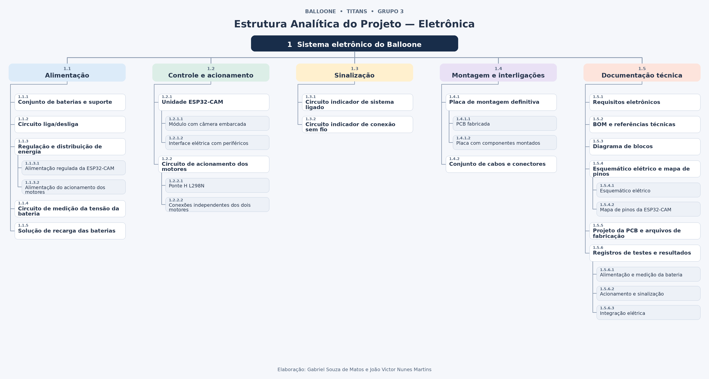

# Estrutura Analítica do Projeto — Eletrônica

A EAP organiza as entregas do sistema eletrônico do Balloone.

Esta versão parcial contempla os ramos 1.1 — Alimentação, 1.2 — Controle e acionamento, 1.3 — Sinalização, 1.4 — Montagem e interligações e 1.5 — Documentação técnica.

## Representação visual

## Entregas

| Código | Entrega | Descrição |
| --- | --- | --- |
| 1.1 | Alimentação |  Sistema de fornecimento, distribuição e monitoramento de energia do robô. |
| 1.1.1 | Conjunto de baterias e suporte | Duas células 18650 em série, com tensão nominal de 7,4 V e máxima de 8,4 V, acomodadas em suporte apropriado. |
| 1.1.2 | Circuito liga/desliga | Chave física para acionamento e interrupção da alimentação principal. |
| 1.1.3 | Regulação e distribuição de energia | Circuito que fornece tensões compatíveis com a unidade de controle e com o acionamento dos motores.|
| 1.1.3.1 | Alimentação regulada da ESP32-CAM | Linha de 5 V regulada pelo LM2596 para alimentar a ESP32-CAM. |
| 1.1.3.2 | Alimentação do acionamento dos motores | Linha de alimentação da ponte H, dimensionada para o acionamento dos dois motores dentro dos seus limites elétricos. |
| 1.1.4 | Circuito de medição da tensão da bateria | Circuito que adapta a tensão do conjunto ao ADC da ESP32-CAM, com erro máximo de ±0,2 V após calibração.|
| 1.1.5 | Solução de recarga das baterias | Carregador compatível com as células e com a forma de recarga adotada. |
| 1.2 | Controle e acionamento | Hardware responsável pelo processamento embarcado e pelo acionamento dos motores |
| 1.2.1 | Unidade ESP32-CAM | Unidade de processamento e captura de imagem, com conexões para os periféricos. |
| 1.2.1.1 | Módulo com câmera embarcada | Módulo ESP32-CAM que executa o firmware e captura as imagens utilizadas pelo robô. |
| 1.2.1.2 | Interface elétrica com periféricos | Conexões da ESP32-CAM com a ponte H, os indicadores luminosos e o circuito de medição da bateria. |
| 1.2.2 | Circuito de acionamento dos motores | Conjunto que permite acionar os dois motores DC de forma independente e nos dois sentidos. |
| 1.2.2.1 | Ponte H L298N | Módulo de potência que recebe os sinais de controle da ESP32-CAM e aciona os motores. |
| 1.2.2.2 | Conexões independentes dos dois motores | Ligações de cada motor ao seu respectivo canal da ponte H. |
| 1.3 | Sinalização | Circuitos indicadores do estado do robô. |
| 1.3.1 | Circuito indicador de sistema ligado | LED amarelo com resistor para indicar que o robô está ligado. |
| 1.3.2 | Circuito indicador de conexão sem fio | LED vermelho com resistor e conexão à ESP32-CAM para indicar o estado da conexão. |
| 1.4 | Montagem e interligações | Placa definitiva e conexões entre os módulos. |
| 1.4.1.1 | PCB fabricada | Placa de circuito impresso produzida conforme o layout e os arquivos de fabricação. |
| 1.4.1.2 | Placa com componentes montados | PCB com os componentes fixados e conectados conforme o esquemático elétrico. |
| 1.4.2 | Conjunto de cabos e conectores | Interligações entre os módulos, com fixação, isolamento e acesso para manutenção. |
| 1.5 | Documentação técnica | Documentos e registros técnicos da área de Eletrônica. |
| 1.5.1 | Requisitos eletrônicos | Especificação dos requisitos funcionais e não funcionais. |
| 1.5.2 | BOM e referências técnicas | Lista de componentes, quantidades, especificações, justificativas e datasheets disponíveis. |
| 1.5.3 | Diagrama de blocos | Representação dos principais módulos eletrônicos e suas conexões entre eles. |
| 1.5.4 | Esquemático elétrico e mapa de pinos | Documentação das ligações do circuito e da atribuição dos pinos da ESP32-CAM. |
| 1.5.4.1 | Esquemático elétrico | Representação dos componentes, das linhas de alimentação e das ligações elétricas do circuito. |
| 1.5.4.2 | Mapa de pinos da ESP32-CAM | Registro dos GPIOs atribuídos aos periféricos, com as restrições aplicáveis a cada conexão. |
| 1.5.5 | Projeto da PCB e arquivos de fabricação | Layout da placa e arquivos necessários para sua fabricação. |
| 1.5.6 | Registros de testes e resultados | Evidências das verificações elétricas, com medições, resultados e limitações encontradas. |
| 1.5.6.1 | Alimentação e medição da bateria | Registro das tensões de alimentação e do erro da leitura da bateria após calibração. |
| 1.5.6.2 | Acionamento e sinalização | Registro da resposta dos dois motores aos comandos e do funcionamento dos indicadores luminosos. |
| 1.5.6.3 | Integração elétrica | Registro das verificações de continuidade, das interligações e do funcionamento conjunto dos módulos. |