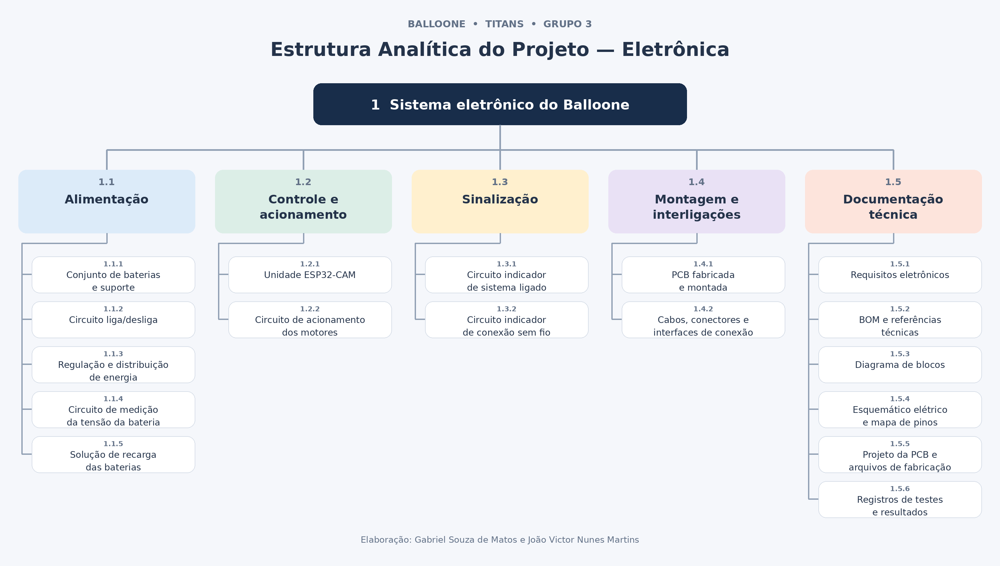

# Estrutura Analítica do Projeto — Eletrônica

A EAP organiza as entregas do sistema eletrônico do Balloone.

Esta versão parcial contempla os ramos 1.1 — Alimentação, 1.2 — Controle e acionamento, 1.3 — Sinalização, 1.4 — Montagem e interligações e 1.5 — Documentação técnica.

## Representação visual

## Entregas

| Código | Entrega | Descrição |
| --- | --- | --- |
| 1.1 | Alimentação | Conjunto responsável pelo fornecimento, regulação e monitoramento da energia. |
| 1.1.1 | Conjunto de baterias e suporte | Duas células 18650 em série e suporte apropriado. |
| 1.1.2 | Circuito liga/desliga | Chave física para acionamento e interrupção da alimentação principal. |
| 1.1.3 | Regulação e distribuição de energia | Regulador LM2596 e distribuição da alimentação com tensões compatíveis com os componentes. |
| 1.1.4 | Circuito de medição da tensão da bateria | Circuito de medição compatível com os limites elétricos da ESP32-CAM. |
| 1.1.5 | Solução de recarga das baterias | Carregador compatível com as células e com a forma de recarga adotada. |
| 1.2 | Controle e acionamento | Hardware de controle e acionamento dos motores. |
| 1.2.1 | Unidade ESP32-CAM | Módulo de controle eletrônico e suas interfaces elétricas. |
| 1.2.2 | Circuito de acionamento dos motores | Ponte H L298N e conexões para acionar os dois motores DC de forma independente. |
| 1.3 | Sinalização | Circuitos indicadores do estado do robô. |
| 1.3.1 | Circuito indicador de sistema ligado | LED amarelo com resistor para indicar que o robô está ligado. |
| 1.3.2 | Circuito indicador de conexão sem fio | LED vermelho com resistor e conexão à ESP32-CAM para indicar o estado da conexão. |
| 1.4 | Montagem e interligações | Placa definitiva e conexões entre os módulos. |
| 1.4.1 | PCB fabricada e montada | Placa física com os componentes montados conforme o projeto elétrico. |
| 1.4.2 | Cabos, conectores e interfaces de conexão | Interligações elétricas entre os módulos. |
| 1.5 | Documentação técnica | Documentos e registros técnicos da área de Eletrônica. |
| 1.5.1 | Requisitos eletrônicos | Especificação dos requisitos funcionais e não funcionais. |
| 1.5.2 | BOM e referências técnicas | Lista de componentes, quantidades, especificações, justificativas e datasheets disponíveis. |
| 1.5.3 | Diagrama de blocos | Representação dos principais módulos eletrônicos e suas conexões. |
| 1.5.4 | Esquemático elétrico e mapa de pinos | Ligações elétricas do circuito e identificação dos GPIOs utilizados. |
| 1.5.5 | Projeto da PCB e arquivos de fabricação | Layout e arquivos necessários ao processo de fabricação escolhido. |
| 1.5.6 | Registros de testes e resultados | Evidências das verificações elétricas, medições e limitações encontradas. |